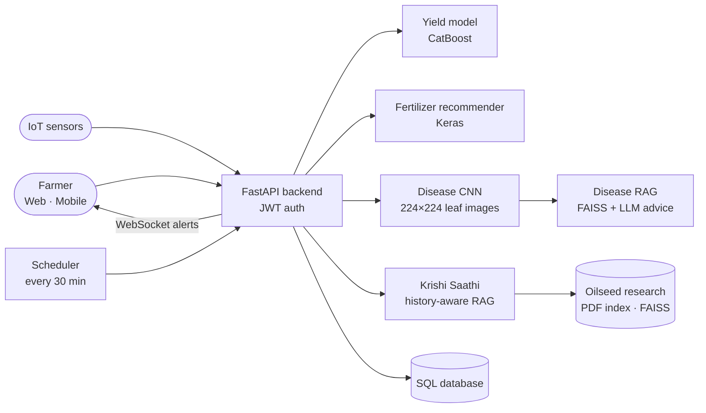

<div align="center">

# 🌾 AgriSutra

**An AI-powered farm assistant for oilseed farmers: yield prediction, leaf-disease detection, a research-grounded agronomy chatbot and live field monitoring, on web and mobile.**


</div>

---

## Why AgriSutra

Oilseed farmers (mustard, groundnut, soybean, sunflower, safflower, castor, niger and more) make most decisions without timely, personalised advice. AgriSutra puts four tools in one app:

| Feature | What the farmer gets |
|---|---|
| 📈 **Yield prediction** | An expected yield for a field from soil nutrients, weather and crop inputs, with the factors that matter most |
| 🍃 **Disease detection** | Upload a leaf photo, get the likely disease and research-backed treatment and prevention steps |
| 💬 **Krishi Saathi chatbot** | Ask farming questions in their own language and get answers grounded in oilseed research documents |
| 📡 **Live field monitoring** | Soil-moisture and sensor readings, weather, NDVI and alerts pushed to the dashboard in real time |

---

## How it works



### 1. Yield prediction and recommendations
A **CatBoost** regression model predicts yield from field features (nutrients, rainfall, temperature and other agronomic inputs). A **Keras** model with a saved preprocessing pipeline recommends fertilizer for the field. Predictions are stored per field so farmers can track them over time.

### 2. Leaf-disease detection with RAG advice
A **CNN** classifies the uploaded leaf image (resized to 224×224 and normalised). The predicted disease is then used to query a **FAISS** index of plant-pathology material (`all-MiniLM-L6-v2` embeddings), and an LLM writes practical treatment and prevention steps from the retrieved passages, in the farmer's chosen language. If the CNN is unavailable, the endpoint falls back to a vision LLM.

### 3. Krishi Saathi — the agronomy chatbot
A **history-aware retrieval chain** (LangChain) over a library of oilseed research and advisory PDFs: crop-wise best practices, feature-wise yield ranges and benchmark practices. Follow-up questions are rewritten using the conversation history before retrieval, and each conversation keeps its own chat memory.

### 4. Real-time monitoring and alerts
IoT devices post sensor readings to the API; readings are stored per user and pushed to open dashboards over **WebSockets**. An **APScheduler** job checks weather and soil-moisture conditions every 30 minutes and sends alerts when action is needed.

---

## Tech stack

| Layer | Tools |
|---|---|
| **Backend** | FastAPI, SQLAlchemy, Pydantic, JWT auth, WebSockets, APScheduler |
| **ML / DL** | CatBoost, TensorFlow / Keras (fertilizer model + disease CNN), scikit-learn preprocessing, joblib |
| **GenAI / RAG** | LangChain, FAISS, HuggingFace `all-MiniLM-L6-v2` embeddings, OpenAI-compatible LLMs |
| **Web app** | Next.js, React, TypeScript, Tailwind CSS, i18n (multilingual UI), maps, weather and NDVI widgets |
| **Mobile app** | Flutter (Android / iOS): fields, crop details, AI assistant and alerts screens |

---

## API overview

| Area | Endpoints |
|---|---|
| **Auth** | `POST /auth/register` · `POST /auth/login` · `GET/PUT /auth/me` |
| **Krishi Saathi** | `POST /chat` · `POST /predict` · `POST /recommend` · `GET /weather` · `GET /ndvi` |
| **Fields** | `POST /fields` · `GET /fields` · `GET /fields/{field_id}/analysis` |
| **Disease** | Leaf-image upload → CNN prediction + RAG advice |
| **IoT** | `POST /sensor` · `POST /update` · `GET /latest` · `GET /my-logs` |
| **Live updates** | WebSocket channel for sensor readings and alerts |

Full request/response examples: [`agnisutra/API_DOCUMENTATION.md`](agnisutra/API_DOCUMENTATION.md) · database schema: [`agnisutra/DB_SCHEMA.md`](agnisutra/DB_SCHEMA.md) · integration notes: [`agnisutra/INTEGRATION_GUIDE.md`](agnisutra/INTEGRATION_GUIDE.md)

---

## Project structure

```
agnisutra/
├── backend/            FastAPI app
│   └── app/
│       ├── main.py             app startup: loads models and FAISS indexes
│       ├── routers/            auth, krishi_saathi, disease, iot, yield_pred, admin
│       ├── krishi_saathi_llm.py  history-aware RAG advisor
│       ├── scheduler.py        30-minute weather and moisture checks
│       ├── manager.py          WebSocket connection manager
│       └── data/               oilseed research PDFs for the knowledge base
├── frontend/           Next.js web dashboard
└── mobile/             Flutter app
```

---

## Run it locally

**Backend**
```bash
cd agnisutra/backend
python -m venv .venv && source .venv/bin/activate
pip install -r requirements.txt
# create a .env with OPENAI_API_KEY (and database settings if not using the default)
uvicorn app.main:app --reload --port 8000
```
API docs are then available at `http://localhost:8000/docs`.

**Web app**
```bash
cd agnisutra/frontend
pnpm install
pnpm dev        # http://localhost:3000
```

**Mobile app**
```bash
cd agnisutra/mobile
flutter pub get
flutter run
```

---

## Roadmap

- Replace the mock weather source in the scheduler with a live weather API
- Add a model card with evaluation metrics for the yield and disease models
- Docker Compose for one-command setup

---

<div align="center">

Built by **[Aditya Raj](https://github.com/Aditya365x)** · B.Tech, NIT Rourkela · [LinkedIn](https://www.linkedin.com/in/aditya-raj-2766621b5/)

</div>
